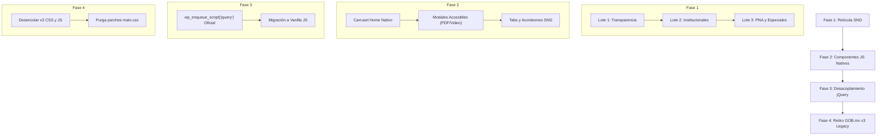

# Plan de Trabajo Técnico — Migración al Estándar SND v1.1.0

> **Documento normativo de referencia obligatorio:**  
> [snd-v1.1.0-extraccion.md](./snd-v1.1.0-extraccion.md)  
> *Fuente oficial: [Sistema Nacional de Diseño (SND)](https://www.snd.gob.mx/) — Versión 1.1.0.*

---

## 1. Guía de Ejecución para Modelos de Inteligencia Artificial (Prompting Context)

Cualquier modelo de IA o agente automatizado que ejecute tareas de este plan debe cumplir estrictamente las siguientes reglas:

1. **Apego normativo estricto:** No inventar clases CSS, nombres de componentes ni patrones de diseño. Todas las clases a utilizar deben existir en el archivo [snd-v1.1.0-extraccion.md](./snd-v1.1.0-extraccion.md) o estar provistas por la hoja `snd-guinda.css` v1.1.0.
2. **Prohibición de nuevas dependencias:** No añadir TailwindCSS, Bootstrap 5 externo, librerías pesadas de terceros ni plugins innecesarios. Se utiliza HTML semántico, CSS del framework SND v1.1.0 y JavaScript moderno nativo (Vanilla JS).
3. **Preservación de lógica de negocio:** En archivos PHP de WordPress (`template-*.php`, `page-*.php`, `functions.php`), no alterar bucles de WordPress (`WP_Query`, `have_posts()`, `the_post()`), llamadas a Advanced Custom Fields (`get_field()`, `the_field()`), ni llamadas a endpoints AJAX o nonces de seguridad.
4. **Verificación incremental:** Las tareas deben ejecutarse por lotes pequeños (máximo 2 a 3 archivos por paso), verificando la sintaxis PHP (`php -l`), ausencia de errores de consola y la correcta renderización HTML antes de avanzar al siguiente lote.
5. **Cero regresiones de accesibilidad (WCAG 2.1 AA):** Todo elemento interactivo debe contar con atributos ARIA correspondientes, soporte para navegación por teclado, contraste mínimo (4.5:1 texto regular, 3:1 títulos según Sección 4.14) y respeto a `prefers-reduced-motion` (Sección 4.9).

---

## 2. Matriz de Equivalencias Normativas (Bootstrap v3/v5 ➔ SND v1.1.0)

Basado en la sección **3.5 Retícula** y **3.1 Colores** de [snd-v1.1.0-extraccion.md](./snd-v1.1.0-extraccion.md):

### 2.1 Contenedores y Estructura Base
| Bootstrap (Legacy v3/v5) | Estándar SND v1.1.0 | Especificación Normativa SND |
|---|---|---|
| `.container` | `.contenedor` | Centrado automático, max-width 1416px en XL, márgenes responsivos (16px móvil, 24px tablet, 56px desktop). (Sección 3.5) |
| `.container-fluid` | `.contenedor--fluido` | Ancho 100% sin restricción de max-width. (Sección 3.5) |
| `.row` (Layout Grid) | `.reticulaGrid__12` | CSS Grid de 12 columnas con gap responsivo por defecto (16px móvil/tablet, 24px desktop). (Sección 3.5) |
| `.row` (Layout Flex) | `.fila` | Contenedor flex con `flex-wrap: wrap` y gap responsivo. (Sección 3.5) |
| `.d-flex.align-items-center` | `.reticulaFlex.align-items-center` | Contenedor flex en una sola línea (`flex-wrap: nowrap`). (Sección 3.5) |

### 2.2 Breakpoints y Columnas
> ⚠️ **Atención IA:** Los breakpoints de Bootstrap son `sm: 576px, md: 768px, lg: 992px, xl: 1200px`.  
> Los breakpoints del SND v1.1.0 son:  
> `sm: 576px` (móvil horizontal), `md: 640px` (tableta), `lg: 1024px` (escritorio), `xl: 1536px` (pantalla ancha). (Sección 3.5)

| Bootstrap (Legacy) | Estándar SND v1.1.0 | Comportamiento |
|---|---|---|
| `.col-12` | `.columna__12` | 100% de ancho (12/12) |
| `.col-md-6` | `.columna__6--md` | 50% de ancho desde breakpoint tableta (≥640px) |
| `.col-lg-4` | `.columna__4--lg` | 33.33% de ancho desde breakpoint escritorio (≥1024px) |
| `.col-lg-3` | `.columna__3--lg` | 25% de ancho desde breakpoint escritorio (≥1024px) |
| `.col-lg-8` | `.columna__8--lg` | 66.66% de ancho desde breakpoint escritorio (≥1024px) |
| `.w-100` | `.col-100` | Ocupa el 100% del contenedor en fila o grid |
| `.order-first` | `.order--primero` | `order: -1` (Sección 3.5) |
| `.order-last` | `.order--ultimo` | `order: 99` (Sección 3.5) |

### 2.3 Espaciados y Gaps
| Bootstrap (Legacy) | Estándar SND v1.1.0 | Valores Permitidos SND (Sección 3.5) |
|---|---|---|
| `.g-2` / `.gap-2` | `.gap--8` | Valores gap: `0, 2, 4, 8, 12, 16, 24, 32, 40` |
| `.g-3` / `.gap-3` | `.gap--16` | Gap estándar responsivo (16px) |
| `.g-4` / `.gap-4` | `.gap--24` | Gap amplio (24px) |
| `.gx-*` | `.gapx--*` | Separación horizontal entre columnas |
| `.gy-*` | `.gapy--*` | Separación vertical entre filas (`0..96`) |

---

## 3. Desglose Fase por Fase del Plan de Trabajo

---

### FASE 1: Migración Integral de Retícula (Bootstrap ➔ SND v1.1.0)
*Objetivo:* Eliminar todas las clases `.container`, `.row` y `.col-*` de las 28 plantillas del tema, reemplazándolas por `.contenedor`, `.reticulaGrid__12`, `.fila` y `.columna__*` conforme al estándar.

#### Lote 1.1: Módulo de Transparencia (Prioridad Alta)
Archivos a intervenir:
- [x] [template-transparencia-unidad.php](../../../sesna-v2/template-transparencia-unidad.php) *(Migrado: .contenedor, .reticulaGrid__12, .columna__*, .h1b.patria, .icono--24, verificado HTTP 200)*
- [x] [template-transparencia-solicitudes.php](../../../sesna-v2/template-transparencia-solicitudes.php) *(Migrado: .contenedor, .boton__primario, blindaje the_field, verificado HTTP 200)*
- [x] [template-transparencia-normatividad.php](../../../sesna-v2/template-transparencia-normatividad.php) *(Migrado: .contenedor, .reticulaGrid__12, tipografía h1b/h4b/h5b/h6b.patria, iconos oficiales icono--*, verificado HTTP 200)*
- [x] [template-transparencia-denunciasincumplimiento.php](../../../sesna-v2/template-transparencia-denunciasincumplimiento.php) *(Migrado: .contenedor, .fila, .boton__secundario.boton--grande, snd-download icono--24, verificado HTTP 200)*
- [x] [template-transparencia-datospersonales.php](../../../sesna-v2/template-transparencia-datospersonales.php) *(Migrado: .contenedor, .reticulaGrid__12, tipografía h1b.patria y h5b, iconos icono--*, verificado HTTP 200)*
- [x] [template-transparencia-comite.php](../../../sesna-v2/template-transparencia-comite.php) *(Migrado: .contenedor, .reticulaGrid__12, tipografía h1b.patria y h5b, iconos icono--*, verificado HTTP 200)*
- [x] [template-transparencia-archivos.php](../../../sesna-v2/template-transparencia-archivos.php) *(Migrado: .contenedor, .reticulaGrid__12, utilidades muestra--ninguno muestra--bloque--md, icono--20, verificado HTTP 200)*
- [x] [template-parts/transparencia/header.php](../../../sesna-v2/template-parts/transparencia/header.php) *(Migrado: .contenedor, .fila, .columna__auto.flex-grow, reticulaFlex, icono--16, verificado HTTP 200)*

#### Lote 1.2: Módulo Institucional y Páginas Estáticas
Archivos a intervenir:
- [x] [page-que-hacemos.php](../../../sesna-v2/page-que-hacemos.php) *(Migrado: retícula completa, h1b/h2b/sh1b patria, limpieza iconos snd-*, verificado HTTP 200)*
- [x] [template-contacto.php](../../../sesna-v2/template-contacto.php) *(Migrado: retícula completa, h1b patria, iconos oficiales icono--*, utilidades muestra--ninguno muestra--bloque--md, verificado HTTP 200)*
- [x] [page-directorio.php](../../../sesna-v2/page-directorio.php) *(Migrado: limpieza de 18 iconos con clases duplicadas, clases de tamaño icono--*, tipografía h1b/sh1b patria, verificado HTTP 200)*
- [x] [page-como-vamos.php](../../../sesna-v2/page-como-vamos.php) *(Migrado: retícula responsiva, display oficial muestra--ninguno muestra--bloque--lg, snd-renew icono--16, tipografía h1b/h2b patria, data-bs-toggle/dismiss, verificado HTTP 200)*
- [x] [page-organos-colegiados.php](../../../sesna-v2/page-organos-colegiados.php) *(Migrado: retícula, display oficial muestra--ninguno muestra--flex--md, títulos h1b/h2b patria, limpieza iconos snd-*, verificado HTTP 200)*
- [x] [page-recursos-humanos.php](../../../sesna-v2/page-recursos-humanos.php) *(Migrado: retícula y utilidades muestra--ninguno muestra--bloque--md, iconos oficiales snd-*, tipografía h1b patria, data-bs-toggle, verificado HTTP 200)*
- [x] [template-preguntas-frecuentes.php](../../../sesna-v2/template-preguntas-frecuentes.php) *(Migrado: h1b patria, utilidades muestra--ninguno muestra--bloque--md, snd-download icono--16, verificado HTTP 200)*
- [x] [template-conocenos.php](../../../sesna-v2/template-conocenos.php) *(Migrado: títulos h1b/h2b patria, utilidades muestra--ninguno muestra--bloque--md/sm, iconos oficiales snd-logo--x, snd-email y snd-launch, verificado HTTP 200)*

#### Lote 1.3: Módulo PNA (Política Nacional Anticorrupción) y Administración
Archivos a intervenir:
- [x] [page-politica-nacional-anticorrupcion.php](../../../sesna-v2/page-politica-nacional-anticorrupcion.php) *(Migrado: retícula .contenedor/.reticulaGrid__12, tipografía h1b/h2b patria, depuración de 12 iconos snd-*, tamaños icono--*, verificado HTTP 200)*
- [x] [page-diseno-pna.php](../../../sesna-v2/page-diseno-pna.php) *(Migrado: retícula .fila/.reticulaGrid__12/.columna__*, display oficial muestra--ninguno muestra--flex--lg, corrección de tabindex/x snd-star a 0, títulos h1b/h2b patria, depuración de 36 iconos oficiales, verificado HTTP 200)*
- [x] [page-programa-implemetancion-pna.php](../../../sesna-v2/page-programa-implemetancion-pna.php) *(Migrado: retícula .contenedor/.fila, display oficial muestra--ninguno, corrección de tabindex/frameborder snd-star a 0, títulos h1b/h2b patria, depuración de 12 iconos oficiales, verificado HTTP 200)*
- [x] [page-seguimiento-evaluacion.php](../../../sesna-v2/page-seguimiento-evaluacion.php) *(Migrado: retícula .contenedor/.reticulaGrid__12/.fila, h1b/h2b patria, iconos oficiales snd-download icono--16, grilla responsiva de indicadores, verificado HTTP 200)*
- [x] [page-seguimiento-evaluacion2.php](../../../sesna-v2/page-seguimiento-evaluacion2.php) *(Migrado: retícula .contenedor/.reticulaGrid__12/.fila, h1b/h2b patria, iconos oficiales snd-download icono--16, grilla responsiva de indicadores, sintaxis PHP verificada)*
- [x] [page-riesgos-inteligencia.php](../../../sesna-v2/page-riesgos-inteligencia.php) *(Migrado: retícula .contenedor/.reticulaGrid__12, display oficial muestra--ninguno muestra--flex--md, títulos h1b/h2b patria, depuración de 20 iconos oficiales, verificado HTTP 200)*
- [x] [page-presupuestacion.php](../../../sesna-v2/page-presupuestacion.php) *(Migrado: retícula .contenedor/.reticulaGrid__12, display oficial muestra--ninguno, títulos h1b/h2b patria, depuración de 18 iconos oficiales, verificado HTTP 200)*
- [x] [page-planeacion-institucional.php](../../../sesna-v2/page-planeacion-institucional.php) *(Migrado: retícula .contenedor, display oficial muestra--ninguno, icono--16 oficial, verificado HTTP 200)*
- [x] [page-informacion-financiera.php](../../../sesna-v2/page-informacion-financiera.php) *(Migrado: retícula .contenedor, icono--16 oficial, verificado HTTP 200)*
- [x] [page-contrataciones-adquisiciones.php](../../../sesna-v2/page-contrataciones-adquisiciones.php) *(Migrado: retícula .contenedor, display oficial muestra--ninguno, icono--16 oficial, verificado HTTP 200)*
- [x] [page-verificacion-patrimonial.php](../../../sesna-v2/page-verificacion-patrimonial.php) *(Migrado: retícula .contenedor/.reticulaGrid__12, títulos h1b/h2b patria, depuración de 13 iconos oficiales, verificado HTTP 200)*
- [x] [page-derechos-humanos.php](../../../sesna-v2/page-derechos-humanos.php) *(Migrado: retícula .contenedor/.reticulaGrid__12 en PHP y JS, display oficial muestra--ninguno muestra--flex--md, corrección de tabindex snd-star a 0, títulos h1b/h2b patria, depuración de iconos snd-*, tamaños icono--*, verificado HTTP 200)*

#### Lote 1.4: Partes de Plantilla (template-parts) y Blog
Archivos a intervenir:
- [x] [template-parts/administracion-finanzas/archivo-documental-contenido.php](../../../sesna-v2/template-parts/administracion-finanzas/archivo-documental-contenido.php) *(Migrado: retícula .reticulaGrid__12/.columna__*, display oficial muestra--ninguno, tipografía h2b patria, depuración de iconos snd-*, tamaños icono--*, verificado HTTP 200)*
- [x] [template-parts/administracion-finanzas/contrataciones-contenido.php](../../../sesna-v2/template-parts/administracion-finanzas/contrataciones-contenido.php) *(Migrado: retícula .reticulaGrid__12, display oficial muestra--ninguno, títulos h1b patria, depuración de iconos snd-*, tamaños icono--*, verificado HTTP 200)*
- [x] [template-parts/administracion-finanzas/informacion-financiera-contenido.php](../../../sesna-v2/template-parts/administracion-finanzas/informacion-financiera-contenido.php) *(Migrado: retícula .reticulaGrid__12, display oficial muestra--ninguno, títulos h1b/h2b patria, depuración de 14 iconos oficiales, verificado HTTP 200)*
- [x] [template-parts/administracion-finanzas/planeacion-institucional-contenido.php](../../../sesna-v2/template-parts/administracion-finanzas/planeacion-institucional-contenido.php) *(Migrado: retícula .reticulaGrid__12, tipografía h1b.patria, depuración de iconos snd-*, tamaños icono--*, verificado HTTP 200)*
- [x] [template-parts/content/single.php](../../../sesna-v2/template-parts/content/single.php) *(Migrado: retícula .fila/.columna__*, títulos h1b patria, saneamiento de iconos snd-*, tamaños icono--*, botones oficiales SND, verificado HTTP 200 en single post)*
- [x] [template-parts/header-blog.php](../../../sesna-v2/template-parts/header-blog.php) *(Migrado: retícula .contenedor, títulos h1b patria, botón oficial boton__secundario)*
- [x] [index.php](../../../sesna-v2/index.php) y [search.php](../../../sesna-v2/search.php) *(Migrado: retícula .contenedor/.reticulaGrid__12/.columna__*, icono oficial snd-renew icono--16, verificado HTTP 200 en home y búsqueda)*

**Criterio de Aceptación (DoD Fase 1):**  
Ejecutar `grep -rnE 'class="[^"]*\b(container|row|col-(xs|sm|md|lg|xl)?-?[0-9]+)\b' sesna-v2/` y obtener **0 coincidencias** en todos los archivos PHP del tema.

---

### FASE 2: Reemplazo de Componentes JS de Bootstrap por SND / Equivalentes Nativos
*Objetivo:* Eliminar la necesidad de `bootstrap.js` (incluido en `gobmx.js`), migrando los 4 patrones interactivos a componentes nativos accesibles alineados al SND v1.1.0.

#### 2.1 Carrusel del Home (`#homeCarousel`) [COMPLETADO]
- **Archivo:** [template-parts/home/carousel.php](../../../sesna-v2/template-parts/home/carousel.php) *(Migrado: carrusel autónomo y accesible en Vanilla JS sin Bootstrap ni jQuery, soporte a prefers-reduced-motion, pausa accesible en focus/hover, botones e indicadores nativos SND, verificado HTTP 200 en home)*
- **Problema actual:** Utiliza `data-bs-ride="carousel"`, `bootstrap.Carousel` y `jQuery('#homeCarousel').carousel()`.
- **Solución técnica según SND v1.1.0:**
  1. El SND (Sección 5.1 Página Principal) prioriza banners institucionales y no incluye carrusel en su librería JS.
  2. Implementar un deslizador accesible y ligero en Vanilla JS o con CSS Scroll Snap (`scroll-snap-type: x mandatory`).
  3. Controles anterior/siguiente usando botones nativos del SND: `.boton__fantasma` con iconos `<i class="snd__icono snd-chevron--left"></i>` y `snd-chevron--right` (Sección 3.2).
  4. Indicadores inferiores con botones accesibles (`aria-label="Ir a diapositiva N"`).
  5. Soporte obligatorio para accesibilidad: pausar autoplay al hacer `:focus` o `:hover`, y desactivar transiciones automáticas si `window.matchMedia('(prefers-reduced-motion: reduce)').matches` (Sección 4.9).

#### 2.2 Visor Universal de Documentos PDF y Modales de Video [COMPLETADO]
- **Archivos:**
  - [template-parts/visor-pdf.php](../../../sesna-v2/template-parts/visor-pdf.php) (`#pdfViewerModal`)
  - [functions.php](../../../sesna-v2/functions.php) y [page-organos-colegiados.php](../../../sesna-v2/page-organos-colegiados.php) (`#oc-video-modal`)
  - [page-derechos-humanos.php](../../../sesna-v2/page-derechos-humanos.php) (`#modal-campania`, `#modal-catalogo`)
  - [template-parts/sesion/content-publish.php](../../../sesna-v2/template-parts/sesion/content-publish.php) y [script/sesiones.js](../../../sesna-v2/script/sesiones.js) (`#modal-video_*`)
- **Migración implementada:**
  1. Controlador modal universal en Vanilla JS (`window.sndModal`) sin dependencia de `bootstrap.Modal` ni `$.fn.modal`.
  2. Overlay oficial SND: `rgba(22, 26, 29, 0.56)` (neutro-800 al 56%).
  3. Cuerpos modales con sombra Drop LV 3 (`0px 6px 12px rgba(0,0,0,0.2)`), esquinas redondeadas 16px, botones de cierre oficiales `.boton__fantasma` con icono `snd-close icono--20` y `data-modal-dismiss`.
  4. Cierre automático con tecla Escape y clic en backdrop.
  5. Corrección de 5 incidencias heredadas del bug numérico `snd-star` a `0`.
- **Solución técnica según SND v1.1.0:**
  1. Reemplazar la estructura por el elemento nativo HTML5 `<dialog class="snd-modal" id="...">` o contenedor modal accesible en Vanilla JS.
  2. Fondo overlay: Color institucional exacto del SND (Sección 3.1): `neutro-800 al 56%` (`rgba(22, 26, 29, 0.56)`).
  3. Cuerpo modal: `fondo--neutro100`, bordes redondeados (`border-radius: 8px` o `16px`), sombra "Drop LV 3" (`0px 6px 12px 0px rgba(0,0,0,0.2)`) según especificaciones de componentes del SND (Sección 4.1, Sección 4.12).
  4. Botón de cierre: `<button type="button" class="boton__fantasma" aria-label="Cerrar modal"><i class="snd__icono snd-close icono--24"></i></button>` (Sección 3.2, Sección 4.2).
  5. Manejo de foco (focus trap) y cierre automático con tecla `Escape`.

#### 2.3 Acordeones y Secciones Colapsables [COMPLETADO]
- **Archivos:** [functions.php](../../../sesna-v2/functions.php) (`.tx-oc-anexos-toggle`), [page-diseno-pna.php](../../../sesna-v2/page-diseno-pna.php) (`#accordionAnexos`), [template-parts/header-blog.php](../../../sesna-v2/template-parts/header-blog.php) (`#collapseExample`).
- **Migración implementada:**
  1. Migración a `
` con `
` accesible y nativo en `page-diseno-pna.php` (Sección 4.4, 4.5, 4.6 SND v1.1.0).
  2. Sustitución de `data-bs-toggle="collapse"` por utilidades SND `muestra--ninguno` y controladores nativos en `functions.php` y `header-blog.php`.
  3. Cero dependencias de Bootstrap Collapse en todos los archivos PHP del tema. Verificado HTTP 200.

#### 2.4 Pestañas / Tabs [COMPLETADO]
- **Archivos:** [page-recursos-humanos.php](../../../sesna-v2/page-recursos-humanos.php), [template-transparencia-comite.php](../../../sesna-v2/template-transparencia-comite.php).
- **Migración implementada:**
  1. Estructura WAI-ARIA estándar SND: `role="tablist"`, botones con `role="tab"`, `aria-selected` y paneles con `role="tabpanel"`.
  2. Sustitución de `data-bs-toggle="tab"` y `data-toggle="tab"` por `data-tab-target` y utilidad SND `muestra--ninguno`.
  3. Controladores nativos en Vanilla JS para intercambio accesible de paneles. Verificado HTTP 200.

**Criterio de Aceptación (DoD Fase 2) [COMPLETADO]:**  
Ejecutado `grep -rnE 'data-bs-|data-toggle|data-dismiss|bootstrap\.' sesna-v2/` con resultado: **0 coincidencias**. Todos los modales (PDF universal, videos de sesiones, campañas DH, catálogo flipbook, recomendaciones y exhortos), acordeones/colapsables, tabs y carrusel funcionan de manera fluida, autónoma y nativa sobre SND v1.1.0. Verificado HTTP 200 en todas las rutas clave.

---

### FASE 3: Desacoplamiento y Gestión de jQuery
*Objetivo:* Asegurar que el sitio no dependa de la inyección oculta de jQuery que hacía `gobmx.js`, permitiendo retirar dicho script sin que los scripts propios del tema fallen.

#### 3.1 Subfase 3A: Independización Inmediata (Estabilidad)
Actualmente, los siguientes 8 scripts del tema hacen llamadas `jQuery(...)` o `$(...)`:
1. [script/home.js](../../../sesna-v2/script/home.js)
2. [script/home-entries.js](../../../sesna-v2/script/home-entries.js)
3. [script/blog.js](../../../sesna-v2/script/blog.js)
4. [script/quehacemos.js](../../../sesna-v2/script/quehacemos.js)
5. [script/sesiones.js](../../../sesna-v2/script/sesiones.js)
6. [script/directorio.js](../../../sesna-v2/script/directorio.js)
7. [script/transparencia.js](../../../sesna-v2/script/transparencia.js)
8. [script/accesibilidad-patch.js](../../../sesna-v2/script/accesibilidad-patch.js)

**Acción técnica:**
- En [sesna-v2/functions.php](../../../sesna-v2/functions.php), actualizar las dependencias de los scripts en `sesna_theme_scripts()`: cambiar `'gobmx-framework-js'` por `'jquery'` (el jQuery registrado oficialmente por el core de WordPress).
- De esta manera, si `gobmx-framework-js` se apaga, jQuery sigue cargándose de forma limpia y controlada por WordPress.

#### 3.2 Subfase 3B: Migración Progresiva a Vanilla JS
- Migrar las peticiones AJAX de `home.js`, `home-entries.js` y `blog.js` de `$.ajax()` / `$.get()` a la API moderna `fetch()`.
- Reemplazar selectores `$('.elemento')` por `document.querySelectorAll('.elemento')`.
- Reemplazar `$(...).on('click', ...)` por `addEventListener('click', ...)`.
- Una vez migrados los scripts, remover la dependencia de `'jquery'` en `wp_enqueue_script`.

**Criterio de Aceptación (DoD Fase 3) [COMPLETADO]:**  
Los listados dinámicos, filtros de blog, carga de sesiones y acordeones interactivos funcionan sin depender del script de GOB.mx v3. Todos los scripts del tema dependen de `'jquery'` oficial de WordPress o de Vanilla JS puro.

---

### FASE 4: Retiro Definitivo de GOB.mx v3 Legacy y Purga de CSS [COMPLETADO]
*Objetivo:* Eliminar la carga de los 2.4 MB de `main.css` legacy y los scripts obsoletos de `gm/v3`, dejando el tema operando 100% sobre SND v1.1.0 con rendimiento óptimo.

#### 4.1 Desencolado en `functions.php` [COMPLETADO]
En [sesna-v2/functions.php](../../../sesna-v2/functions.php) dentro de `sesna_theme_scripts()`:
- Desencolado `gobmx-framework` (`gm/v3/assets/styles/main.css`).
- Desencolado `gobmx-framework-js` (`gm/v3/assets/js/gobmx.js`).
- `snd-v1` (`snd-guinda.css`) opera de manera independiente y directa.

#### 4.2 Purga de Parches de Corrección en `assets/css/main.css` [COMPLETADO]
- [x] Regla `html { height: auto !important; }` que combatía `body { height: 100vh }` de GOB.mx v3 removida ([main.css:18-28](../../../sesna-v2/assets/css/main.css)).
- [x] Ocultamiento de la barra vieja `.navbar-fixed-top` inyectada por `gobmx.js` removido ([main.css:442-448](../../../sesna-v2/assets/css/main.css)).
- [x] Overrides de `.main-footer` inyectado por `gobmx.js` removidos ([main.css:6610-6625](../../../sesna-v2/assets/css/main.css)).

#### 4.3 Auditoría de Identidad Gráfica y Componentes [COMPLETADO]
Verificado conforme a [snd-v1.1.0-extraccion.md](./snd-v1.1.0-extraccion.md):
- [x] **Header (Sección 4.7):** Escudo oficial con `<i class="snd__icono snd-gobierno-mexico mexico__img color--origen" aria-hidden="true"></i>` y enlace de salto accesible `.irContent` con tabulador hacia `#mainContent`.
- [x] **Navbar (Sección 4.4):** `.subheader` y `.navHeader` con estilo guinda oficial (`presidencia guinda-950`).
- [x] **Tipografía (Sección 3.4):** Encabezados con clases `h0b`, `h1b`, `h2b`, `sh0b` y `.patria` únicamente donde corresponde.
- [x] **Botones (Sección 4.2):** Todos los botones migrados a `.boton__primario`, `.boton__secundario` o `.boton__fantasma`.
- [x] **Footer (Sección 4.6):** `<footer class="footer">` con enlaces obligatorios, atributos `target="_blank" rel="noopener" title="El enlace abre en ventana nueva"`, escudo oficial `<i class="snd__icono snd-gobierno-mexico footer__escudo color--origen">`, redes sociales oficiales `snd-snd-*` y línea 079 con `snd-snd-079`.

---

## 4. Checklist de Validación y Criterios de Aceptación Final [COMPLETADO]

Al concluir las 4 fases, el repositorio cumple todas las condiciones requeridas:

1. **Inspección de red (Network DevTools):**
   - [x] No se solicita `https://framework-gb.cdn.gob.mx/gm/v3/assets/styles/main.css` (0 referencias en el HTML generado).
   - [x] No se solicita `https://framework-gb.cdn.gob.mx/gm/v3/assets/js/gobmx.js` (0 referencias en el HTML generado).
   - [x] El CSS de SND (`https://framework-gb.cdn.gob.mx/snd/v1.1.0/snd-guinda.css`) carga con status 200.
   - [x] El JS de SND (`https://framework-gb.cdn.gob.mx/snd/v1.1.0/snd.js`) carga antes de `</body>` con status 200.
   - [x] Los iconos y fuentes cargan directamente desde `/snd/v1.1.0/` sin redirecciones ni 404.
2. **Validación de Código:**
   - [x] 0 archivos PHP con clases de rejilla de Bootstrap (`container`, `row`, `col-*`).
   - [x] 0 archivos PHP con atributos `data-bs-*` o `data-toggle`.
   - [x] Sintaxis PHP 100% limpia sin errores en todos los archivos del tema.
   - [x] Todas las rutas clave responden con código HTTP 200 OK.
